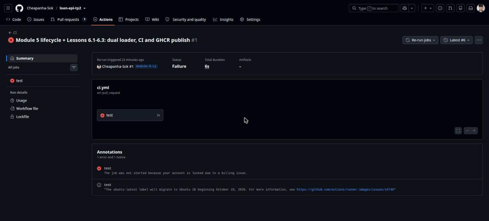
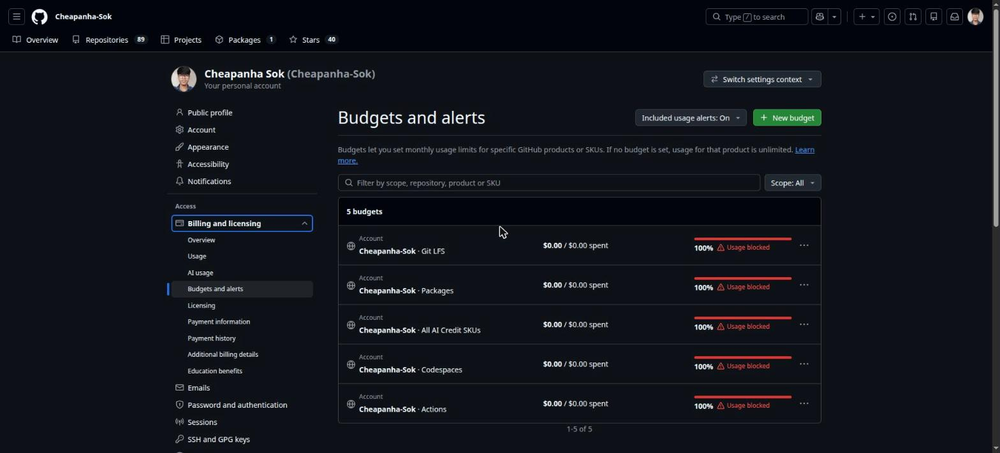
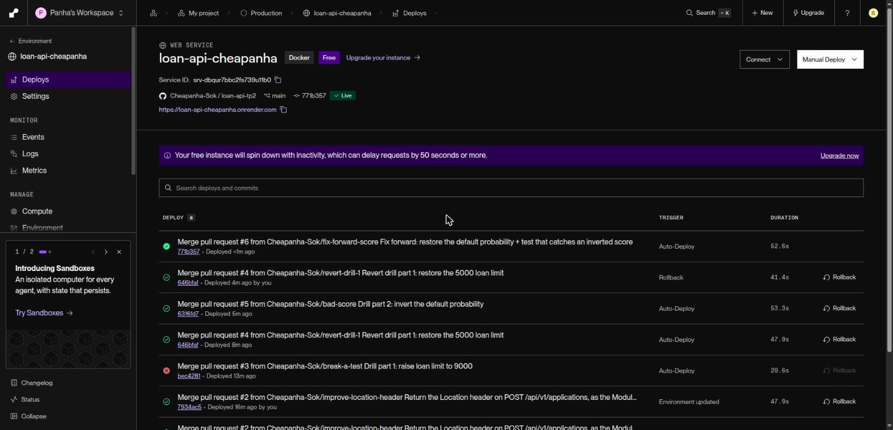
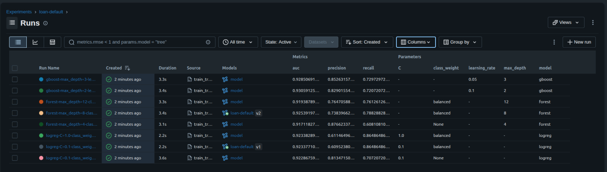
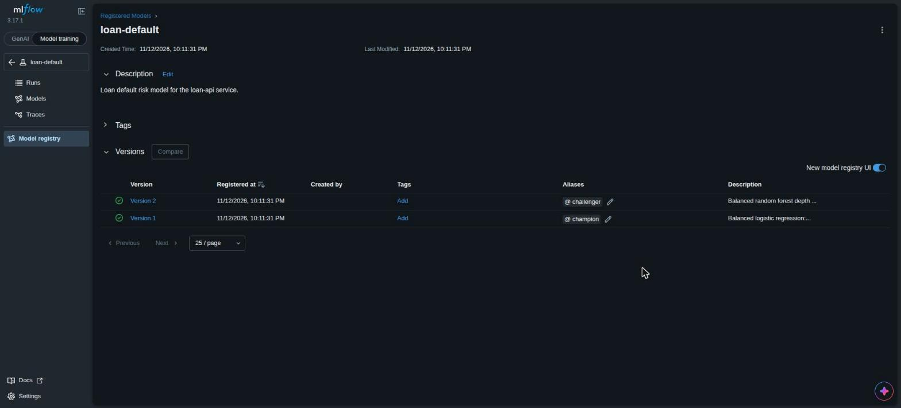
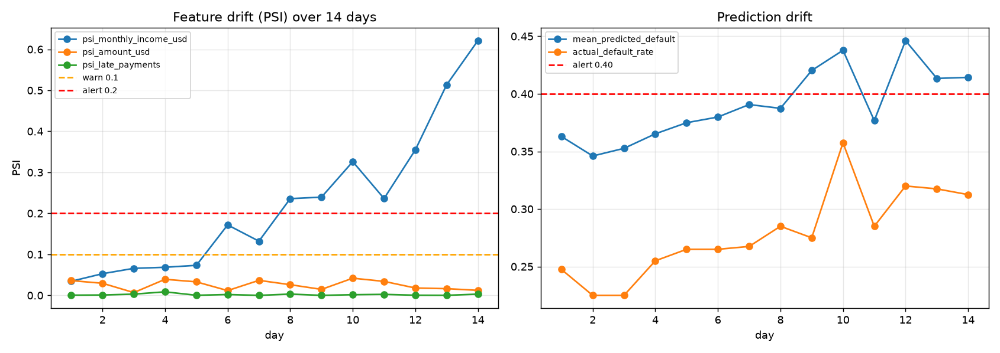
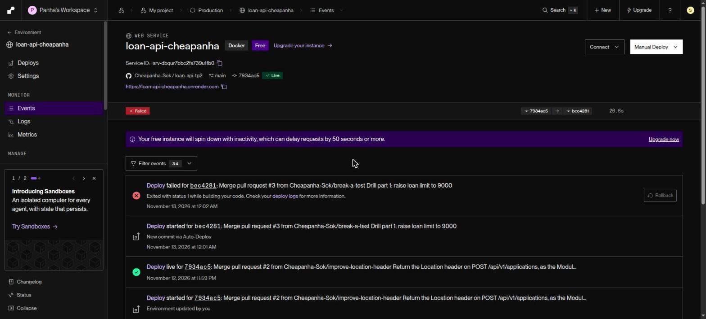
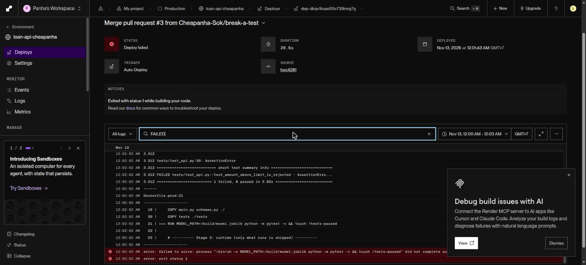
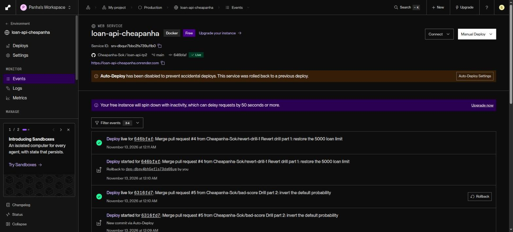

# Task 6.7: Capstone, From Code to Production

**Student:** Sok Cheapanha · **Course:** AI Engineering & Deployment, Module 6 · **Date:** 12–13 November 2026

| | |
|---|---|
| Repository | https://github.com/Cheapanha-Sok/loan-api-tp2 (public, branch `main`) |
| Live app | https://loan-api-cheapanha.onrender.com ([/docs](https://loan-api-cheapanha.onrender.com/docs), [/health](https://loan-api-cheapanha.onrender.com/health)) |
| Host | Render free web service, Singapore, built from `Dockerfile.prod`, auto-deploy on every commit to `main` |
| Live version at submission | `git_sha` `771b357` (PR #6), model `1.0.0` |

## 0. Important: GitHub Actions was blocked by an account billing lock

The course pipeline runs on GitHub Actions. On this account every Actions job was refused before it started:

```
The job was not started because your account is locked due to a billing issue.
```

The run (PR #1, `ci.yml`) was attempted 6 times on 12 Nov (the original run plus 5 re-runs, the last at 16:15 UTC); each attempt failed in under 10 s with no log. We checked the billing pages: plan **GitHub Free**, $0 usage, $0 of $12 included compute used, **no payment method and no payment history**, repository public. The only unusual setting is five account budgets at **$0.00 marked "Usage blocked"** (Actions, Packages, Codespaces, Git LFS, AI credits). The lock is an account flag on GitHub's side; a support request is the follow-up. Full write-up: `evidence/6.7/github-actions-billing-lock.md`.





**Workaround (same stages, no GitHub Actions):** the pipeline runs on **Render's Git-backed build**, which is still fully automatic: nobody ever deploys by hand.

| Course stage (GitHub Actions) | What runs instead |
|---|---|
| `test` job | A `test` stage inside `Dockerfile.prod`: `python train.py` then `pytest -v` against the exact code and model that will ship. The runtime stage copies a marker file from it, so **no green tests, no image, no deploy**. |
| `build-and-push` to GHCR | Render builds `Dockerfile.prod` from the repository on every commit to `main` (GHCR is pushed from Actions, so it is unavailable too) |
| `deploy` (deploy hook) | Render **Auto-Deploy: On Commit** |
| `verify` (`/health` shows the SHA) | Render's health check on `/health` gates every release; `/health` reports `git_sha` from `RENDER_GIT_COMMIT`; `scripts/verify.sh` waits until the live SHA equals the merged commit and prints the merge-to-live time |
| Branch protection requiring `test` | **Not possible** without a CI status check. All changes still went through pull requests (#1 to #6). |

`ci.yml` and `publish.yml` stay in the repository unchanged, so the course pipeline (and branch protection) can be switched on as soon as GitHub lifts the lock.

## 1. Requirements and evidence

| Requirement | Modules | Evidence | Status |
|---|---|---|---|
| Live `/openapi.json` matches the contract | 2, 3 | §2 side-by-side comparison | Met (deliberate differences explained) |
| All tests pass in CI; main is protected | 3, 6 | §3: tests run in every Render build (8 passed); a failing test blocked a release | Partly: CI runs in the build; branch protection impossible while Actions is locked (§0) |
| Hardened production image stamped with its commit SHA | 4, 6 | §3: multi-stage, slim, non-root, health-checked image; `/health` returns `git_sha` | Met (no registry tags: GHCR blocked, Render stores the image) |
| Tracked runs, registered champion, promotion memo | 5 | §4 (from Task 5.7) | Met |
| Automatic deploy and verify on every merge | 6 | §3: deploy history and `verify.sh` logs | Met (verify run from the terminal, not a CI job) |
| API key in a Render env var; HTTPS graded | 6 | §5: three checks, SSL Labs **A** | Met |
| A deliberate bad release caught or rolled back | 6 | §6: part 1 stopped by tests; part 2 rolled back in 48 s; new test added | Met |
| Drift monitoring with an alert threshold | 5 | §4 (drift chart and alert plan) | Met |

## 2. Step 1: Foundations, live `/openapi.json` vs the Module 2 contract

Contract: Task 2.7 `loan-api.yaml` (OpenAPI 3.0.3). Live: `https://loan-api-cheapanha.onrender.com/openapi.json` (saved as `evidence/6.7/live-openapi.json`).

| Contract (Module 2) | Live service | Result |
|---|---|---|
| `POST /applications`: 201 + `Application` + `Location`, 422 on a business rule | `POST /api/v1/applications`: 201 + `Application`, 422 when `amount_usd` > 5000; `Location` added in PR #2 | **Match** (after PR #2) |
| `GET /applications` (paged `ApplicationList`, `next_cursor`) | `GET /api/v1/applications` returns a plain list | **Changed on purpose**: in-memory store, no pagination yet |
| `GET /applications/{application_id}`: 200 / 404 | same path under `/api/v1`: 200 / 404 | **Match** |
| `PATCH /applications/{application_id}` (approve / reject, 409) | not implemented | **Deferred**: manager dashboard out of scope |
| `GET /borrowers/{borrower_id}/applications` | not implemented | **Deferred**: needs the PostgreSQL store |
| `POST /applications/{id}/predictions` | `POST /api/v1/predictions` scores features directly; each application embeds its `prediction` | **Changed on purpose** (Module 3 design) |
| `ApplicationCreate` requires `borrower_id`, `amount_usd`, `term_months` | also requires the three other model features | **Changed on purpose**: the model needs all five |
| Limits: `amount_usd` 100–5000, `term_months` ∈ {3, 6, 12, 18, 24} | identical (`schemas.py`) | **Match** |
| Bearer token on every endpoint | `X-API-Key` on every `/api/` route; `/health`, `/docs` open | **Changed on purpose**: one service key |
| — | `GET /health` (`status`, `model_version`, `git_sha`) | **Added** for Render's health check and verify |

## 3. Step 3: Ship and verify (the pipeline)

**Pipeline:** pull request → merge to `main` → Render clones the commit → `Dockerfile.prod` stage 1 installs packages and trains the model → **stage 2 runs pytest** → stage 3 builds the slim non-root runtime image → Render starts it and waits for `/health` → traffic switches → `verify.sh` confirms the live `git_sha`.

**The one real improvement (PR #2):** the contract requires `POST /applications` to return a `Location` header; the service did not. PR #2 added it with a test assertion.

```
$ APP_URL=https://loan-api-cheapanha.onrender.com scripts/verify.sh
Waiting for https://loan-api-cheapanha.onrender.com to report 7934ac540ec17bdb248847e974d4994ca9f30dca (merged 2026-11-12 23:50:01)
Live version is '268c66d374f2dcff511ac7b7219f70d14f460af0', waiting (1/45)
Live version is '268c66d374f2dcff511ac7b7219f70d14f460af0', waiting (2/45)
Live version is '268c66d374f2dcff511ac7b7219f70d14f460af0', waiting (3/45)
Deployed and healthy: 7934ac540ec17bdb248847e974d4994ca9f30dca
Merge to live: 1 min 5 s

$ curl -si -X POST $APP/api/v1/applications -H 'content-type: application/json' -d '{"borrower_id":1042,"amount_usd":1500,...}'
HTTP/2 201
location: /api/v1/applications/7781
```

**Merge-to-live times** (every merge, measured by `verify.sh` from the merge commit to the live `git_sha`):

| PR | Change | Merge to live |
|---|---|---|
| #2 | `Location` header (the improvement) | **1 min 5 s** |
| #3 | drill part 1, broken rule | never live (build failed at `test`) |
| #4 | revert of #3 | 1 min 4 s |
| #5 | drill part 2, inverted score | 1 min 5 s |
| #6 | fix forward + new test | 1 min 10 s |



**Hardened image, stamped with its commit:** `Dockerfile.prod` is multi-stage (`python:3.12-slim`), applies Debian security updates, runs as non-root `appuser` (uid 10001), ships only `main.py`, `schemas.py`, the venv and the model (no MLflow, no tests, no secrets), and has a `HEALTHCHECK`. Locally it uses about 141 MiB, well under Render's 512 MB. `/health` reports the commit:

```
{"status":"ok","model_version":"1.0.0","git_sha":"771b35729380301e28e23b13a3d323ee0badbeda"}
```

## 4. Step 2: The model lifecycle (Module 5, Task 5.7)

From `report/submission_sokcheapanha_5.7.pdf` in the repository:

- **Eight tracked runs, three model types** (logistic regression, random forest, gradient boosting), each logging parameters, AUC, recall, precision, the ROC curve and the model with its signature.
- **Registered model `loan-default`:** version 1 (balanced logistic regression, recall 0.865, AUC 0.923) is `@champion`; version 2 (balanced random forest, depth 8, recall 0.788, precision 0.738) is `@challenger`.
- **Promotion memo:** recall is the primary metric because a missed defaulter (lost principal) costs far more than a false alarm (a manual review). The champion catches 86.5% of defaulters against 72–79% for the alternatives at essentially the same AUC.
- **The API in production** loads `model.joblib` trained inside the image (version `1.0.0`, the same balanced logistic regression, test AUC 0.923); with `MLFLOW_TRACKING_URI` set it loads `models:/loan-default@champion` instead (Lesson 6.1).





**Drift monitoring and alert plan:** a 14-day simulated drift run (incomes falling $8/day) logged PSI per feature and the mean predicted default.



| Signal | Threshold | Action |
|---|---|---|
| PSI `monthly_income_usd` | Warn > 0.1 for 2 days (fired day 7) | Notify the team, check field reports |
| PSI `monthly_income_usd` | Alert > 0.2 for 2 days (fired day 9) | Retrain, register a new `@challenger`, compare, promote |
| Mean predicted default | Alert > 0.40 for 2 days (fired day 10) | Tell credit managers, review approval limits |
| Recall on arrived outcomes | Alert if < 0.80 (monthly) | Retrain or promote the challenger |

## 5. Step 4: Secure

The API key is generated with `secrets.token_urlsafe(32)` and stored only in **Render → Environment → `API_KEY`** (and the student's password store). It is in no file, no image and no log.

```
# Lesson 6.6 checks against https://loan-api-cheapanha.onrender.com (2026-11-12 17:00:16 UTC)
$ curl -s $APP/health                                   # open: always 200
{"status":"ok","model_version":"1.0.0","git_sha":"7934ac540ec17bdb248847e974d4994ca9f30dca"}  -> HTTP 200
$ curl -s $APP/api/v1/applications                      # no key: 401
{"detail":"Missing or invalid API key"}  -> HTTP 401
$ curl -s -H "X-API-Key: wrong" $APP/api/v1/applications  # wrong key: 401
{"detail":"Missing or invalid API key"}  -> HTTP 401
$ curl -s -H "X-API-Key: $KEY" $APP/api/v1/applications   # with the key: 200
[]  -> HTTP 200
```

**SSL Labs:** overall grade **A** on both Render endpoints (216.24.57.16 and 216.24.57.18); TLS 1.2 and TLS 1.3 only; certificate issued by Google Trust Services (WE1), valid until 20 Dec 2026 and renewed automatically by Render (`evidence/6.7/step4-ssllabs.json`).

**No secrets anywhere:** the key string occurs 0 times in the full Git history and the working tree; no deploy-hook URL, `.env`, database or model file is committed; the image's environment contains only `MODEL_PATH` and `GIT_SHA`; GitGuardian on PR #1 reported "No secrets detected".

## 6. Step 5: Break and recover (bad release drill)

### Part 1: a break the tests check, stopped by the pipeline

PR #3 changed `le=5000` to `le=9000` in `schemas.py` and was merged (`bec4281`, 17:01:40 UTC). Render's build ran the test stage and failed; the release never reached users and production stayed on `7934ac5`.

```
FAILED tests/test_api.py::test_amount_above_limit_is_rejected - AssertionError
1 failed, 6 passed in 2.62s
error: failed to solve: process "/bin/sh -c MODEL_PATH=/build/model.joblib python -m pytest -v && touch /tests-passed" did not complete successfully: exit code 1
$ curl -s $APP/health   ->  {"status":"ok","model_version":"1.0.0","git_sha":"7934ac5..."}
```





PR #4 reverted it (live in 1 min 4 s).

### Part 2: a break the tests do not check, rolled back

PR #5 made `score` return `round(1 - probability, 3)`. All 7 tests still passed, so it shipped.

| Time (UTC) | Event | Safe applicant (1500 USD, 12 m, income 350, 0 late) | Risky applicant (5000 USD, 3 m, income 200, 4 late) |
|---|---|---|---|
| 17:08:07 | Before (live `646bfaf`) | 0.095, low | 1.0, high |
| 17:09:04 | PR #5 merged | | |
| 17:10:09 | Bad release live (`6316fd7`), **merge to live 1 min 5 s** | **0.905, low** (probability and band disagree) | **0.0, high** |
| 17:10:48 | Rollback clicked in Render's Events tab (to `646bfaf`) | | |
| 17:11:36 | Recovered, **rollback to recovered 48 s** | 0.095, low | 1.0, high |
| 17:14:52 | Fix forward PR #6 live (`771b357`, 1 min 10 s) | 0.095, low | 1.0, high |

The wrong version was live for 1 min 27 s in total. Render disables auto-deploy after a rollback; it was switched back to **On Commit** before the fix was merged.



**The real fix: a test that would have caught it (PR #6).**

```python
def test_risky_applicant_scores_higher_than_safe_applicant(client):
    safe = client.post("/api/v1/predictions", json=GOOD).json()
    risky = client.post("/api/v1/predictions", json=RISKY).json()
    assert risky["default_probability"] > safe["default_probability"]
    assert safe["risk_band"] == "low" and safe["default_probability"] < 0.2
    assert risky["risk_band"] == "high" and risky["default_probability"] >= 0.5
```

```
# re-applying the inverted line locally:
FAILED tests/test_api.py::test_risky_applicant_scores_higher_than_safe_applicant
1 failed, 7 passed
# with the fix: 8 passed
```

Because the tests run inside the Docker build, the same mistake can no longer reach production.

## 7. Step 6: Presentation

The 5-minute slides are submitted separately (`slides_sokcheapanha_6.7.pdf`): architecture, one design decision, one trade-off, and what comes next.

## 8. Assessment criteria checklist

| Criterion | How it is met |
|---|---|
| Every requirement met, with evidence | §1 table; partial items explained by the GitHub billing lock (§0) |
| Deployed only by the pipeline, never by hand | Every deploy in Render's history is Auto-Deploy from a merge, plus the drill rollback (screenshot §3). No manual deploy, no `docker push`, no deploy hook was used. |
| No secrets in the repository, the images or the logs | §5 scan: 0 occurrences; key only in Render's environment |
| The bad release was caught or rolled back, and a test now prevents it | §6: part 1 blocked by tests; part 2 rolled back in 48 s; new test fails on the bug |

**Teardown** (after assessment, Lesson 6.7 Hands-on 2): delete the Render service, remove the `API_KEY`, keep the repository as a portfolio.
