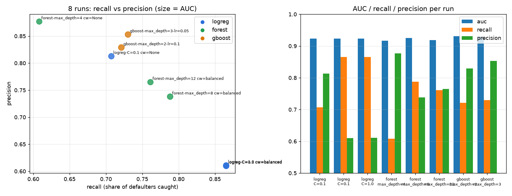
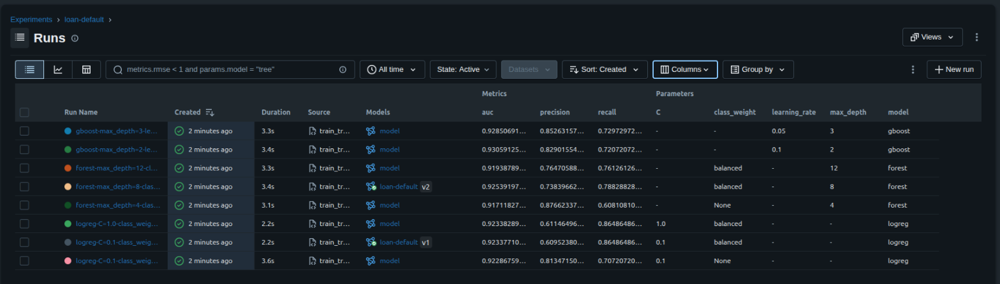
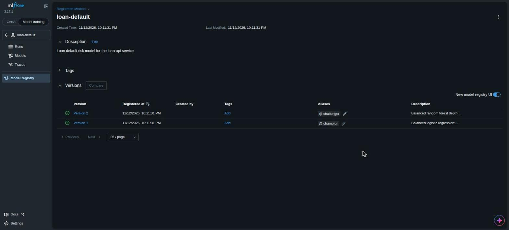
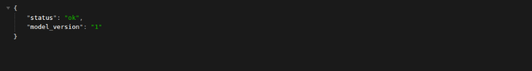
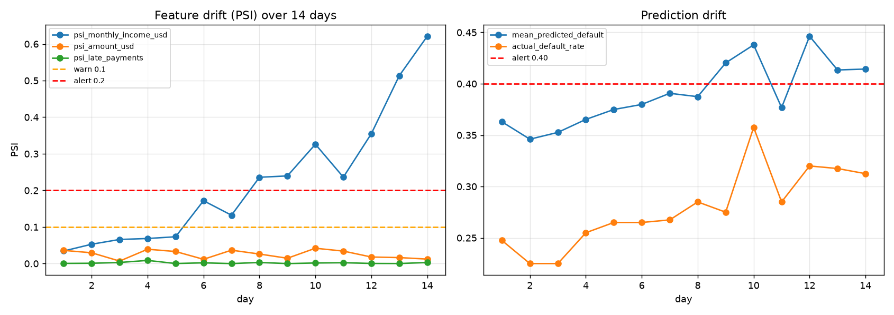
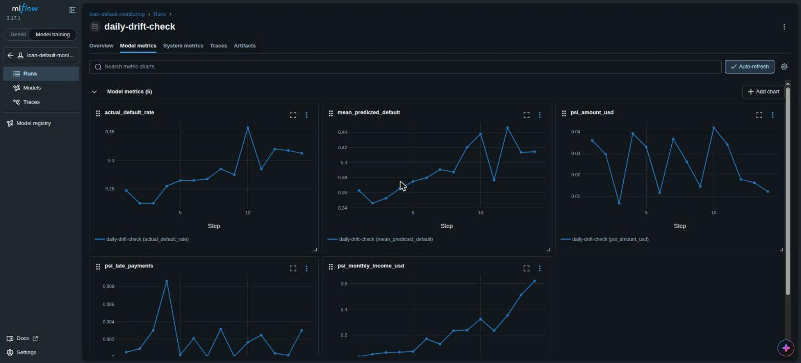

# Task 5.7: Run the Full Model Lifecycle

**Student:** Sok Cheapanha · **Course:** AI Engineering & Deployment, Module 5 · **Repo:** `loan-api-tp2`, branch `module-5-mlflow`

Tracking server: `mlflow server --host 127.0.0.1 --port 5000 --backend-store-uri sqlite:///mlflow.db --artifacts-destination ./mlartifacts` (MLflow 3.17.1). Scoring server on port 5001, FastAPI loan service on port 8000.

## Deliverables checklist

| # | Deliverable | Evidence in this report |
|---|---|---|
| 1 | At least six tracked runs, two or more model types | 8 runs, 3 model types: experiment table, comparison chart, MLflow runs screenshot (§1) |
| 2 | `loan-default` with 2+ versions, champion and challenger aliases, descriptions | Registry screenshot (§2) |
| 3 | Promotion decision using recall, precision and AUC | Memo with run links (§3) |
| 4 | MLflow scoring server tested, including a signature rejection | curl outputs (§4.1) |
| 5 | FastAPI loads `@champion`; `/health` shows the registry version | Screenshot and curl (§4.2) |
| 6 | Fourteen-day drift run with alert thresholds | Charts and alert plan (§5) |
| 7 | Rollback performed and verified | `/health` before and after (§6) |

## 1. Experiment: eight tracked runs

`train_tracked.py` extends Lesson 5.2 from 4 to 8 runs: three logistic regressions, three random forests and two gradient-boosting models. Every run logs its parameters, `auc`, `recall` and `precision` (threshold 0.5), `roc_curve.png` and the model with its signature and `pyfunc_predict_fn="predict_proba"`. Command: `python train_tracked.py` (with `MLFLOW_TRACKING_URI=http://127.0.0.1:5000`).

| Run | Model | AUC | Recall | Precision |
|---|---|---|---|---|
| logreg-C=0.1-class_weight=None | logreg | 0.923 | 0.707 | 0.813 |
| **logreg-C=0.1-class_weight=balanced** (v1, champion) | logreg | 0.923 | **0.865** | 0.610 |
| logreg-C=1.0-class_weight=balanced | logreg | 0.923 | 0.865 | 0.611 |
| forest-max_depth=4-class_weight=None | forest | 0.917 | 0.608 | 0.877 |
| **forest-max_depth=8-class_weight=balanced** (v2, challenger) | forest | 0.925 | 0.788 | 0.738 |
| forest-max_depth=12-class_weight=balanced | forest | 0.919 | 0.761 | 0.765 |
| gboost-max_depth=2-learning_rate=0.1 | gboost | **0.931** | 0.721 | 0.829 |
| gboost-max_depth=3-learning_rate=0.05 | gboost | 0.929 | 0.730 | 0.853 |





## 2. Registry: champion and challenger

Registered with `register.py` (same as **Register model** in the UI), with a description on the model and on each version:

| Version | Alias | Source run | Description |
|---|---|---|---|
| 1 | `@champion` | `c59515e99fd04561be2c1d5252036a3f` | Balanced logistic regression: highest recall (0.865) with AUC 0.923; catches the most defaulters. |
| 2 | `@challenger` | `0de7d0ea0eea44deb4ef53fe019288a0` | Balanced random forest depth 8: AUC 0.925, recall 0.788, precision 0.738; fewer false alarms. |



## 3. Promotion memo

**Decision: version 1, the balanced logistic regression ([run c59515e9](http://127.0.0.1:5000/#/experiments/1/runs/c59515e99fd04561be2c1d5252036a3f)), is `@champion`. Version 2, the balanced depth-8 random forest ([run 0de7d0ea](http://127.0.0.1:5000/#/experiments/1/runs/0de7d0ea0eea44deb4ef53fe019288a0)), is `@challenger`.** For a microfinance lender, a missed defaulter (a lost principal) costs far more than a false alarm (a loan officer double-checks a good borrower), so recall is the primary metric. The balanced logistic regression catches 86.5% of defaulters, against 78.8% for the best forest and 72.1% for the gradient-boosting model with the top AUC ([run f5ec448f](http://127.0.0.1:5000/#/experiments/1/runs/f5ec448fdde94643965b4e0d71ef60a3), AUC 0.931). Its ranking quality is effectively the same (AUC 0.923 against 0.925 and 0.931), so the higher AUC elsewhere does not offset about 8 to 14 more percentage points of missed defaulters. The cost is precision, 0.610: about 4 in 10 flagged loans would have repaid, which is acceptable because a flag triggers a manual review, not an automatic rejection. The model is also simple and explainable to loan officers. The forest is the challenger because it is the best-balanced alternative (recall 0.788, precision 0.738). If review workload becomes the bottleneck, it is the first candidate to promote, and the rollback drill in §6 shows that switch takes one alias move.

## 4. Serve and integrate

### 4.1 MLflow scoring server (port 5001)

`mlflow models serve -m "models:/loan-default@champion" -p 5001 --env-manager local`

```
$ curl http://127.0.0.1:5001/invocations  (two applicants)
{"predictions": [[0.9054017784694199, 0.09459822153058012], [0.002339021227680149, 0.9976609787723199]]}

$ curl ... misspelled column late_payment            -> HTTP 400 (signature REJECTS)
{"error_code": "INVALID_PARAMETER_VALUE", ... "Error: Model is missing inputs ['late_payments'].
 Note that there were extra inputs: ['late_payment'].", "error_class": "SCHEMA_ENFORCEMENT_FAILED"}

$ curl ... amount_usd sent as text "1500"            -> HTTP 200 (converted, accepted)
{"predictions": [[0.9054017784694199, 0.09459822153058012]]}

$ curl ... amount_usd "fifteen hundred"              -> HTTP 400 (signature REJECTS)
{"error_code": "BAD_REQUEST", "message": "Invalid input. Data is not compatible with model signature.
 Failed to convert column amount_usd to type 'int64'. ..."}
```

The signature blocks a missing column and an impossible type. It silently converts `"1500"` and knows nothing about the $5,000 limit, so business rules stay in FastAPI/Pydantic.

### 4.2 FastAPI loan service loading `@champion` (port 8000)

`main.py` now loads `models:/loan-default@champion` in `lifespan` and reads the version from the registry (`MODEL_NAME` and `MODEL_ALIAS` can be overridden with environment variables). There is no file path and no version number in the code. `pytest`: **5 passed**.

```
$ curl http://127.0.0.1:8000/health
{"status":"ok","model_version":"1"}
$ curl -X POST http://127.0.0.1:8000/api/v1/predictions   (applicant 1)
{"default_probability":0.095,"risk_band":"low","model_version":"1"}
$ curl -X POST http://127.0.0.1:8000/api/v1/predictions   (applicant 2)
{"default_probability":0.998,"risk_band":"high","model_version":"1"}
```

**Same probability from both servers:** 0.0946 → 0.095 and 0.9977 → 0.998.



## 5. Monitor: 14-day drift run and alert thresholds

`python monitor.py` scored 14 simulated days (400 applications per day, incomes falling $8 a day) with the champion and logged PSI per feature, the mean predicted default and the actual default rate to experiment `loan-default-monitoring`, run [daily-drift-check](http://127.0.0.1:5000/#/experiments/2/runs/664035d464db44308b1cea1d00f719cb).

```
day  1: income PSI=0.034 amount PSI=0.036 mean risk=0.363 actual=0.247
day  5: income PSI=0.073 amount PSI=0.033 mean risk=0.375 actual=0.265
day  6: income PSI=0.172 amount PSI=0.012 mean risk=0.380 actual=0.265
day  7: income PSI=0.132 amount PSI=0.037 mean risk=0.391 actual=0.268
day  8: income PSI=0.236 amount PSI=0.026 mean risk=0.387 actual=0.285
day  9: income PSI=0.240 amount PSI=0.015 mean risk=0.420 actual=0.275
day 10: income PSI=0.326 amount PSI=0.042 mean risk=0.438 actual=0.357
day 11: income PSI=0.236 amount PSI=0.034 mean risk=0.377 actual=0.285
day 14: income PSI=0.621 amount PSI=0.012 mean risk=0.414 actual=0.312
```





### Alert plan, justified from the chart

| Signal | Threshold | Why this value (from the chart) | Action | Fired in this run |
|---|---|---|---|---|
| `psi_monthly_income_usd` | **Warn > 0.1 for 2 days in a row** | Days 1–5 stay at 0.03–0.07 (sampling noise); day 6 (0.172) and day 7 (0.132) are the first two consecutive days above it | Notify the team; check field reports for floods or a harvest failure | Day 7 |
| `psi_monthly_income_usd` | **Alert > 0.2 for 2 days in a row** | Days 8–9 (0.236, 0.240) cross it together and it never falls back below 0.2 | Retrain on recent data, register as a new `@challenger`, compare, then promote | Day 9 |
| `psi_amount_usd`, `psi_late_payments` | Warn > 0.1 | They stay below 0.05 and 0.01 all period, so 0.1 cannot be reached by noise | Same as the income warning | Never |
| `mean_predicted_default` | **Alert > 0.40 for 2 days in a row** | Baseline is 0.35–0.37 on days 1–3; it passes 0.40 on days 9–10 (0.420, 0.438), confirming the income drift is reaching the predictions | Tell credit managers; review approval limits | Day 10 |
| `actual_default_rate` (when outcomes arrive) | Recompute recall/AUC monthly; alert if recall < 0.80 | Defaults rose from about 0.25 to about 0.31 | Retrain or promote the challenger | Months later |

Two consecutive days are required because single days are noisy: day 7 is lower than day 6, and day 11 drops back to 0.236 before rising again.

## 6. Rollback drill

`move_alias.py <version>` moves `@champion` (the same as editing the alias in the UI); FastAPI is restarted after each move because it loads the model once, at start-up.

```
== BEFORE (champion -> version 1) ==
$ curl /health
{"status":"ok","model_version":"1"}
{"default_probability":0.095,"risk_band":"low","model_version":"1"}

== PROMOTE challenger: python move_alias.py 2, restart FastAPI ==
$ curl /health
{"status":"ok","model_version":"2"}
{"default_probability":0.062,"risk_band":"low","model_version":"2"}

== ROLLBACK: python move_alias.py 1, restart FastAPI ==
$ curl /health
{"status":"ok","model_version":"1"}
{"default_probability":0.095,"risk_band":"low","model_version":"1"}
```

The live model changed twice and was restored with no code edit and no new image. The registry records every alias move.

## Files added or changed in `loan-api`

| File | Purpose |
|---|---|
| `data.py`, `psi.py` | Shared synthetic data and the PSI function (Lessons 5.2 and 5.6) |
| `train_tracked.py` | 8 tracked runs across 3 model types |
| `register.py`, `move_alias.py` | Register v1/v2 with aliases and descriptions; move `@champion` |
| `monitor.py` | 14-day drift simulation logged with `step=day` |
| `main.py`, `tests/test_api.py` | API loads `models:/loan-default@champion`; health test reads the registry version |
| `requirements.txt`, `.gitignore` | `mlflow==3.17.1`; ignore `mlflow.db` and `mlartifacts/` |
